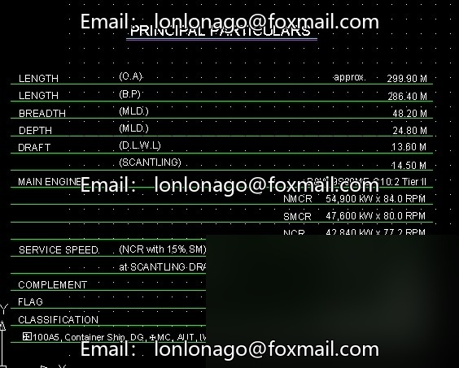
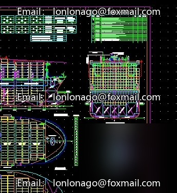
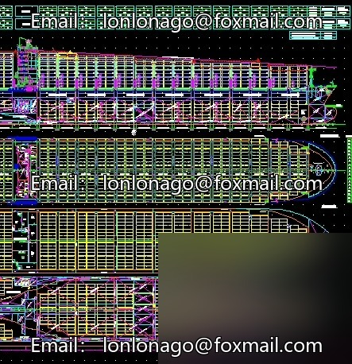
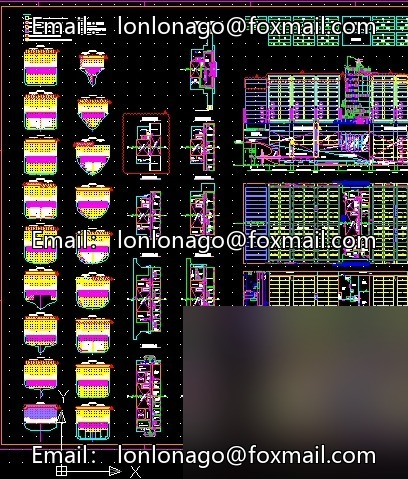

# 300-meter 9,400 TEU container ship drawing materials, various vessel drawings

## Body

300-meter 9400 TEU container vessel drawing materials, various vessel drawings, full set of CAD drawings for type, line, and structure

The drawing material covers a 300-meter, 9,400 TEU container vessel plans, hull lines, structural CAD, and items such as principal dimensions, volume, depth, draft, ship type, engine systems and service speed.

<!-- AI_ENRICHED -->

## Images

## Payment

Here is a pay link on Stripe ( https://buy.stripe.com/3cs8yP7sY87d0vu9AB ). Please contact me lonlonago@foxmail.com after funding $89, and I will send you a complete data files , thank you!

